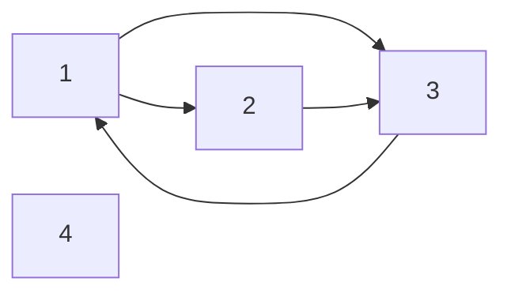

# Maths

In this repository I try some simple math problems in different programming languages.

## Infinite nested radical

The first project solves for `x` when the user enters `y` in:

$$
x + \sqrt{x + \sqrt{x + \sqrt{x + \dots}}} = y
$$

The nested radical equals $\sqrt{y}$, so the solution is:

$$
x = y - \sqrt{y}
$$

## ASCII Mandelbrot set

The second project draws a Mandelbrot fractal directly in the terminal. For
each point $c$, it repeats:

$$
z_{n+1} = z_n^2 + c, \qquad z_0 = 0
$$

Points that do not escape are drawn with `@`; the other characters show how
quickly the sequence grows beyond the escape radius.

Compile and run it with a C++17 compiler:

```sh
c++ -std=c++17 -O2 mandelbrot.cpp -o mandelbrot
./mandelbrot
```

## Logistic map and the route to chaos

`logistic_map.cpp` iterates a simple nonlinear recurrence:

$$
x_{n+1} = r x_n(1-x_n), \qquad 0 \leq r \leq 4
$$

Its ASCII bifurcation diagram samples rates from 2.5 to 4.0. A single branch
splits into two, then four, before densely filled regions and periodic windows
appear. Each `*` marks a vertical bin visited by the sampled orbit. The separate
report for your chosen rate prints the last eight retained states and estimates
local sensitivity using the mean of $\ln|r(1-2x_n)|$. A positive estimate suggests
local expansion along the sampled orbit; a negative one suggests contraction.
The estimate is `-inf` when a sampled derivative is zero.

Try rates `2.8`, `3.2`, and `3.5` to see approximately one, two, and four repeating
values, then `3.9` for an irregular orbit. Every run starts at
$x_0=0.3141592653589793$ and discards 1000 updates. Finite precision, finite sample
counts, and the coarse grid limit the picture: the discarded updates do not
guarantee convergence, narrow windows can be missed, and the sensitivity
estimate does not prove chaos or a period.

Optional arguments are rate (0-4), retained samples per orbit (16-4096), width
(21-161), and height (11-61); defaults: `3.9 256 81 25`. The rate changes the
numeric report; the diagram always spans 2.5-4.0.

```sh
c++ -std=c++17 -O2 logistic_map.cpp -o logistic_map
./logistic_map
./logistic_map 3.2 512 101 31
python3 tests/test_logistic_map.py
```

The test script uses only Python's standard library, builds in a temporary
directory, and accepts `CXX`, `CPPFLAGS`, and `CXXFLAGS` overrides.

## Ulam prime spiral

`ulam_spiral.cpp` places the positive integers in a square spiral and marks
every prime number with `##`. The primes form surprisingly strong diagonal
patterns even though they become less common as the numbers grow.

Compile it with a C++17 compiler and optionally choose an odd grid size from 5
to 99 (the default is 31):

```sh
c++ -std=c++17 -O2 ulam_spiral.cpp -o ulam_spiral
./ulam_spiral 41
```

## Pascal / Sierpinski triangle

Mark only the odd numbers in Pascal's triangle and a Sierpinski pattern appears.
`pascal_sierpinski.cpp` draws those coefficients as `*`. It checks whether
`column & (row - column)` is zero, avoiding factorials and integer overflow.
Choose 1-64 rows (default: 32); powers of two show complete stages of the pattern.

```sh
c++ -std=c++17 -O2 pascal_sierpinski.cpp -o pascal_sierpinski
./pascal_sierpinski 32
```

## Lissajous curves

Combine two oscillations, $x(t) = \cos(at)$ and $y(t) = \sin(bt)$, into a
closed curve. `lissajous.cpp` samples one complete period on an ASCII canvas.
Try `1 1` for a circle in mathematical coordinates (its terminal appearance
depends on character proportions), or `3 2` and `5 4` for interlaced loops.
Both integer frequencies must be 1-9; the defaults are `3 2`.

```sh
c++ -std=c++17 -O2 lissajous.cpp -o lissajous
./lissajous 5 4
```

## Collatz explorer

Start with a positive integer: halve it when even, or replace it with $3n+1$
when odd. `collatz.cpp` prints the trajectory, steps to reach 1, and peak value.
For example, 27 takes 111 steps and reaches 9232. Whether **every** positive
integer eventually reaches 1 is still an unproved conjecture.

The default start is 27. An optional second argument caps the steps at 1-10000
(default: 10000). The program stops with exit code 2 if that limit is reached
before 1, or before a calculation would overflow a 64-bit unsigned integer;
invalid arguments return 1.

```sh
c++ -std=c++17 -O2 collatz.cpp -o collatz
./collatz 27
./collatz 27 20
```

## Birthday paradox

How many people are needed before a shared birthday becomes more likely than
not? `birthday_paradox.cpp` calculates the probability of at least one matching
pair and draws a table with percentage bars. At 23 people it is about 50.73%.

The model assumes independent birthdays distributed uniformly across 365 days,
ignoring leap days. It computes the complement of all birthdays being different:

$$
P(\text{shared}) = 1 - \prod_{k=0}^{n-1}\frac{365-k}{365}, \qquad 0 \leq n \leq 365
$$

For zero or one person the probability is zero; for 366 people it is one.
Choose 0-366 people to highlight in the table (default: 23).

```sh
c++ -std=c++17 -O2 birthday_paradox.cpp -o birthday_paradox
./birthday_paradox 23
```

## Gambler's ruin

`gamblers_ruin.cpp` follows a bankroll that gains one unit with probability $p$
and loses one with probability $q=1-p$. A trial stops at 0 or a chosen target
$N$. The program plots the first trial in ASCII, compares a seeded simulation
with theory, and shows how success probability changes with the starting
bankroll $i$. Even a fair game only reaches the target with probability $i/N$.

For a fair walk ($p=q=1/2$), success probability and expected stopping time are:

$$
P_i = \frac{i}{N}, \qquad E_i[T] = i(N-i)
$$

For $0<p<1$ and $p\ne q$:

$$
P_i = \frac{1-(q/p)^i}{1-(q/p)^N}, \qquad
E_i[T] = \frac{i-NP_i}{q-p}
$$

The program handles $p=0$, $p=1$, and initial boundary states separately. It
evaluates these exact model formulas in floating-point arithmetic, using a
rescaled form to avoid large powers. Trials use independent pseudorandom steps;
the same arguments reproduce the experiment across standard C++ libraries.

Optional arguments are start (0-target), target (2-40), integer win percentage
(0-100), trials (1-10000), seed (0-4294967295), and step limit per trial
(1-10000). Defaults: `10 20 50 10000 42 10000`. The path preview shows at most
60 updates and reports omitted updates. Work is capped at 100 million walk
updates. Invalid arguments return 1; any unresolved trial makes the program
return 2. Such trials remain separate from wins and losses: the output gives
bounds on this batch's eventual success fraction and the mean of the capped
durations. These bounds describe unresolved outcomes, rather than statistical
confidence in the theoretical probability.

```sh
c++ -std=c++17 -O2 gamblers_ruin.cpp -o gamblers_ruin
./gamblers_ruin 10 20 50
./gamblers_ruin 10 20 45 10000 123
./gamblers_ruin 2 4 50 20 42 1  # All trials unresolved; exits 2.
python3 tests/test_gamblers_ruin.py
```

The test script needs Python 3 and a C++17 compiler (`CXX`, `CPPFLAGS`, and
`CXXFLAGS` are supported). It checks the formulas against an exact absorbing
Markov chain calculation, plus boundary states, seeded runs, and step limits.

## Pi convergence race

`pi_convergence.cpp` compares two alternating series for $\pi$:

$$
\text{Leibniz:}\quad \pi = 4\sum_{k=0}^{\infty}\frac{(-1)^k}{2k+1}
$$

$$
\text{Nilakantha:}\quad \pi = 3 + \sum_{k=1}^{\infty}\frac{4(-1)^{k+1}}{(2k)(2k+1)(2k+2)}
$$

Each update adds one term to both series (Nilakantha starts at 3). A table at
1, 10, 100, ... updates, plus your final count, shows the estimates and their
absolute errors against the standard library's value of $\pi$. Nilakantha
converges much faster, but floating-point rounding eventually limits accuracy;
a displayed zero error does not mean the result is mathematically exact.
Choose 1-1000000 updates (default: 10000).

```sh
c++ -std=c++17 -O2 pi_convergence.cpp -o pi_convergence
./pi_convergence 10000
```

## Magic squares

`magic_square.cpp` arranges every integer from 1 to $n^2$ exactly once so that
every row, column, and both main diagonals have the same sum:

$$
M = \frac{n(n^2+1)}{2}
$$

It uses the Siamese method: start at the top center, step up and right with
wraparound, and move down instead if the next cell is occupied. Choose an odd
size from 1 to 25 (default: 5). A 3-by-3 square has magic sum 15.

```sh
c++ -std=c++17 -O2 magic_square.cpp -o magic_square
./magic_square 5
```

## Attention: matrix operations inside a transformer

How does a query decide which information to combine? `attention.cpp` explores
a single scaled dot-product attention head and its derivatives, using only
C++17. It displays the scores, attention weights, weighted output, and entropy
of each weight distribution.

Let $Q$ contain $m$ query rows, $K$ contain $n$ key rows, and $V$ contain $n$
value rows. Queries and keys have $d_k$ coordinates; values have $d_v$.
For temperature $T>0$, without a mask:

$$
S = \frac{QK^T}{\sqrt{d_k}T}, \qquad
A_{ij}=\frac{\exp(S_{ij})}{\sum_\ell\exp(S_{i\ell})}, \qquad O=AV
$$

Each row of $A$ is a probability distribution over the keys, so an output row
is a weighted average of the value rows. A lower temperature concentrates
weights on the largest scores; tied scores remain tied. Temperature is an
adjustable teaching parameter; the default $T=1$ matches the scaled attention
formula in
[Attention Is All You Need, section 3.2.1](https://arxiv.org/html/1706.03762v7#S3.SS2.SSS1).
The division by $\sqrt{d_k}$ compensates for the growing dot-product variance
when query and key coordinates are independent, zero-mean, and unit-variance.

`--causal` allows query $i$ to use only keys $j\leq i$, including itself. Later
positions receive exactly zero weight. This mode requires $m=n$; without a
mask, different query and key counts are supported. In causal mode, the softmax
denominator sums over visible keys only. Softmax subtracts the
largest **visible** score before exponentiating, keeping exponentials at most
one. The report's `scores` are finite values before masking; `weights` contain
the zeros imposed by the mask. Entropy is $-\sum_j A_{ij}\log A_{ij}$ in nats,
with zero-weight terms omitted.

### Following the gradient

`--backward` accepts a matrix $G$ with the same shape as $O$. It represents
the derivative arriving from a later calculation. Holding $G$ fixed, the
program differentiates the scalar probe $L=\sum_{i,d}O_{id}G_{id}$:

$$
B=GV^T, \qquad
D_{ij}=A_{ij}\left(B_{ij}-\sum_\ell A_{i\ell}B_{i\ell}\right)
$$

$$
\frac{\partial L}{\partial Q}=\frac{DK}{\sqrt{d_k}T}, \qquad
\frac{\partial L}{\partial K}=\frac{D^TQ}{\sqrt{d_k}T}, \qquad
\frac{\partial L}{\partial V}=A^TG
$$

Masked entries of $D$ are zero. The implementation evaluates the softmax
derivative with paired contributions $A_{ij}A_{i\ell}(B_{ij}-B_{i\ell})$;
forming value differences first makes identical values yield exactly zero
query and key gradients. This shows the chain rule used in backpropagation.
The program starts from supplied Q, K, and V matrices; learned projections,
multiple heads, an optimizer, and the rest of a transformer are outside this
example.

### Run it

```sh
c++ -std=c++17 -O2 attention.cpp -o attention
./attention
./attention --temperature 0.25
./attention --causal --backward
./attention --backward --json
python3 tests/test_attention.py
```

The built-in demo uses three queries and three keys with two coordinates per
key and value. It includes a fixed signed upstream matrix when `--backward`
is enabled; the report displays that matrix along with the gradients.

Use `--input FILE` or `--input -` for custom data. The first four unsigned
integers are `m n dk dv`, followed by Q, K, and V in row order. With
`--backward`, append G; otherwise, extra values are rejected. For example,
save this as `attention-data.txt`:

```text
1 2 1 1
0
-1 1
-1 1
1
```

Run `./attention --input attention-data.txt --temperature 2 --backward`.
The two keys receive weights $1/2$, the output is zero, and the gradients are
$\partial L/\partial Q=1/2$, $\partial L/\partial K=[0,0]^T$, and
$\partial L/\partial V=[1/2,1/2]^T$. Remove the last line to use this file
without `--backward`.

Limits: 1–16 queries and keys, 1–8 key/value dimensions, and temperature from
`1e-3` to `1e3`. Matrix entries must be finite decimal or scientific notation,
either zero or with magnitude from `1e-100` to `1e6`. These bounds keep scores
and gradient products finite. Very small weights or gradients can round to
zero; saturated attention can have extremely small derivatives. Calculations
use double precision, so sums and derivatives are approximate.

Options may appear in any order, once each. `--help` works alone. Invalid
dimensions, malformed numbers, missing/extra values, and unreadable files
return 1 with a diagnostic on stderr and no stdout. Valid input returns 0.

`--json` emits all input matrices, dimensions, temperature, mask setting,
scores, weights, output, and entropy. `gradients` is `null` in forward mode;
backward mode supplies `upstream`, `objective`, and the derivative matrices
`query`, `key`, and `value`. Every matrix is an array of rows.

The tests use Python's standard library and a C++17 compiler, honoring `CXX`,
`CPPFLAGS`, and `CXXFLAGS`. They compare forward results to an independent
high-precision calculation and gradients to finite differences, alongside
analytic cases, masking, invariance checks, numeric bounds, and invalid input.

## PCA: linear algebra behind data compression

How can we represent a dataset with fewer coordinates while losing as little
information as possible? `pca.cpp` explores principal component analysis (PCA),
using a dependency-free C++17 symmetric Jacobi eigensolver. It prints the
means, covariance matrix, principal directions, explained variance, compressed
coordinates, and reconstructed data.

For an $n\times d$ matrix $X$ with one observation per row, subtract each
feature's mean to obtain $X_c$. The sample covariance is:

$$
C = \frac{X_c^T X_c}{n-1}, \qquad C v_j = \lambda_j v_j
$$

The orthonormal eigenvectors are ordered by decreasing eigenvalue. Keeping
the first $k$ as columns of $V_k$ gives an encoder and decoder:

$$
Z = X_c V_k, \qquad \hat{X} = ZV_k^T + \mathbf{1}\mu^T
$$

Here $Z$ has only $k$ coordinates per observation. These matrix multiplications
are a simple linear version of an autoencoder's compression and reconstruction
steps; PCA computes the weights directly. Among subspaces of dimension $k$,
the principal subspace minimizes squared reconstruction error:

$$
\|X-\hat{X}\|_F^2 = (n-1)\sum_{j>k}\lambda_j
$$

The program computes both sides independently. It also reports the singular
values of the centered data, using $\sigma_j=\sqrt{(n-1)\lambda_j}$. This is the
connection between PCA, eigendecomposition, and singular value decomposition
(SVD). See [Cornell's PCA notes](https://www.cs.cornell.edu/courses/cs3780/2026sp/lectures/UnsupervisedLearning.html#principal-component-analysis)
for the variance and approximation viewpoints.

The built-in demo has eight observations and three features. Its covariance
eigenvalues are $256/7$, $16/7$, and $0.5/7$. Keeping two components preserves
$544/545\approx99.8165\%$ of the variance, with squared reconstruction error
$0.5$. Try all component counts to see the tradeoff:

```sh
c++ -std=c++17 -O2 pca.cpp -o pca
./pca
./pca --components 1
./pca --components 0  # Reconstruct only the mean.
./pca --components 3  # Keep every direction.
./pca --components 2 --json
python3 tests/test_pca.py
```

Supply your own whitespace-separated data with `--input FILE`, or `--input -`
for standard input. The first two integers are the sample and feature counts,
followed by exactly that many rows of values (line breaks are optional):

```text
4 2
1 2
2 4
3 6
4 8
```

For example, save this as `data.txt` and run
`./pca --input data.txt --components 1`. These points lie on a line, so one
component reconstructs them up to floating-point roundoff.

The limits are 2–256 samples and 1–8 features. Choose 0–$d$ components with
`--components K`; the default is `min(2,d)`. Values must be finite decimal or
scientific notation, either zero or with magnitude from `1e-100` to `1e100`.
Options may appear in any order, once each; use `--help` alone for usage.
Malformed input, unreadable files, duplicate options, and extra values are
rejected with no standard output. Valid input returns 0, invalid input returns
1, and a numerical failure returns 2.

`--json` includes all scores and reconstructions; the terminal report previews
the first eight observations. Each row of `axes` is one principal direction,
and the corresponding entries in `eigenvalues`, `singular_values`, and
`explained_variance_ratio` refer to that direction. All $d$ directions are
included, even numerical null directions, regardless of $k$. The ratio is
$\lambda_j/\sum_i\lambda_i$; `retained_variance_ratio` sums the first $k$ ratios.
`reconstruction_sse` is the measured squared error; `discarded_variance_sse`
is the estimate from discarded eigenvalues in the identity above.
For identical observations, the covariance, eigenvalues, scores, and errors
are zero and both variance-ratio fields are `null` because there is no variance
to divide by.

The calculation centers features without standardizing their scales: changing
units can change the principal directions. High variance does not necessarily
mean a feature is useful for prediction. Equal eigenvalues can have different,
equally valid orthonormal bases. The largest-magnitude loading in each printed
direction is made positive; tiny rounding changes at ties can change that sign
without changing the mathematics.

This is a small numerical teaching example. Centering uses offsets from the
first observation, and the covariance is rescaled before Jacobi rotations so
the convergence threshold is relative to the data. The numeric limits keep
intermediate products finite. The squared error is measured in centered
coordinates to avoid subtracting large offsets again. Tiny negative eigenvalues
from roundoff are clamped to zero. Very small directions may be lost relative
to dominant ones: forming the covariance squares the condition number, so a
direct SVD is preferable for demanding numerical work. The two error estimates
can differ at roundoff scale, including when all components are kept.

The tests use Python's standard library and a C++17 compiler, with `CXX`,
`CPPFLAGS`, and `CXXFLAGS` overrides. They check analytic spectra, projection
identities, degenerate data, scaling and translation, and input validation.

## Spanning trees and Kirchhoff's theorem

A spanning tree connects every vertex of a graph without forming a cycle.
`spanning_trees.cpp` counts these trees exactly and can report how often each
edge appears in them. The default 3-by-3 grid has 192 spanning trees.

The graph's Laplacian $L=D-A$ has vertex degrees on the diagonal, $-1$ for
adjacent vertices, and zero elsewhere. Kirchhoff's matrix-tree theorem gives:

$$
\tau(G) = \det L_{\widehat r}
$$

Here $L_{\widehat r}$ removes row and column $r$. The program displays the
matrix obtained by removing the last vertex. It evaluates the determinant
with fraction-free Bareiss elimination and exact 64-bit integer arithmetic.
The graph-size limits keep all intermediate calculations within that range.

With `--edge-stats`, each edge $e=\{u,v\}$ gets an inclusion count and the
exact probability that it belongs to a uniformly chosen spanning tree:

$$
N_e = \det L_{\widehat{u,v}}, \qquad P(e\in T)=\frac{N_e}{\tau(G)}
$$

The second matrix removes both endpoint rows and columns while retaining the
original degrees. This counts trees containing $e$: contract the edge, then
delete the merged vertex from its Laplacian. Fractions are reduced. An edge
with probability 1 is a **bridge**; removing it disconnects the graph. The
inclusion counts sum to $(n-1)\tau(G)$, since every tree has $n-1$ edges.

Invoke it as `./spanning_trees [family [size [edges]]] [--edge-stats]`:

| Family | Size | Graph |
| --- | --- | --- |
| `path` | 1-10 vertices | A chain |
| `cycle` | 3-10 vertices | One closed loop |
| `complete` | 1-10 vertices | Every pair connected |
| `grid` | Side length 1-3 | A square grid, without wrapping |
| `custom` | 1-10 vertices | Explicit edges required |

Defaults are `grid 3`; each built-in family uses size 3 when omitted. Vertex
labels start at 0; grid labels run left to right, top to bottom. `custom`
requires both size and a comma-separated edge list such as `0-1,1-2,2-3`.
Use `-` for no edges. The graph is simple and undirected: self-loops, duplicate
edges (including reversed duplicates), out-of-range vertices, and whitespace
inside an argument are rejected. Edge order and orientation do not affect
the result.

`--edge-stats` may appear once anywhere among the arguments. Use `--help`
alone for usage. Exit codes are 0 for connected graphs or help, 1 for invalid
arguments, and 2 for disconnected graphs. Disconnected graphs have zero
spanning trees and no edge probabilities. A single vertex has one empty tree;
the determinant of its empty cofactor is 1.

```sh
c++ -std=c++17 -O2 spanning_trees.cpp -o spanning_trees
./spanning_trees --edge-stats
./spanning_trees complete 10 --edge-stats  # 100,000,000 trees; each edge has probability 1/5.
./spanning_trees custom 4 0-1,0-2,1-2,2-3 --edge-stats  # Edge 2-3 is a bridge.
./spanning_trees custom 4 0-1,2-3  # Disconnected; exits 2.
python3 tests/test_spanning_trees.py
```

The Python standard-library tests compare the executable with independent
tree enumeration, check the printed matrix and exact edge fractions, and
cover graph families, arbitrary vertex labels, disconnected graphs, input
validation, and the supported limits. They compile in a temporary directory and accept `CXX`,
`CPPFLAGS`, and `CXXFLAGS`. See also the
[MIT notes on the matrix-tree theorem](https://math.mit.edu/~apost/courses/18.212_2021/lectures/18212_lecture19.pdf).

## Lights Out and binary linear algebra

`lights_out.cpp` solves a square Lights Out puzzle. Pressing a cell toggles its
light and each orthogonal neighbor. Edges do not wrap. The goal is to switch
every light off using the fewest presses.

Pressing twice cancels, and press order does not matter. Write the board as a
binary vector $b$ and the press pattern as $x$. If $A$ records which lights
each press toggles, the puzzle becomes:

$$
Ax = b \pmod{2}
$$

Gauss-Jordan elimination uses XOR for row operations. A contradictory row
$0=1$ means the board is impossible. Otherwise, a particular solution $x_0$
and a basis $v_1,\ldots,v_k$ of the kernel give every solution:

$$
x = x_0 + c_1v_1 + \cdots + c_kv_k, \qquad c_i \in \{0,1\}
$$

The program checks all $2^k$ patterns to find the exact minimum number of
presses. It reports the matrix rank, nullity $k$, solution count, minimum
presses, and number of minimum patterns. Ties use row-major lexicographic
order: read left to right, top to bottom, preferring `0` to `1`. Counts refer
to patterns with each cell pressed at most once, not different move orders.

Invoke it as `./lights_out [size [board]] [--basis]`. Choose a size from 1 to 10
(default: 5). An optional board must contain exactly that many slash-separated
binary rows, each of that width, with `1` meaning on. Without a board, every
light starts on. The default 5-by-5 board has rank 23, nullity 2, and four
solutions, all requiring 15 presses.

`--basis` may appear once, before, between, or after the positional arguments;
it displays independent press patterns that leave any board unchanged, even
for an impossible board. Use `--help` alone for usage. Invalid arguments return
1, impossible boards return 2, and solved boards or help return 0.

The search is small even at the supported limit: the first press row determines
each later row by clearing the lights immediately above. Thus at most $2^n$
solutions exist for an $n$-by-$n$ board, so at most 1024 patterns need checking.
All calculations are exact binary arithmetic.

```sh
c++ -std=c++17 -O2 lights_out.cpp -o lights_out
./lights_out
./lights_out 3 010/111/010   # One press at the center solves this cross.
./lights_out 4 --basis
./lights_out 5 10000/00000/00000/00000/00000  # Impossible; exits 2.
python3 tests/test_lights_out.py
```

The Python standard-library tests use an independent row-chasing solver,
exhaust every board up to 3-by-3, and check minimum patterns, kernel bases,
impossible boards, input validation, and all supported sizes. They compile
in a temporary directory and support `CXX`, `CPPFLAGS`, and `CXXFLAGS`.
For the underlying mathematics, see Anderson and Feil's
[Turning Lights Out with Linear Algebra](https://doi.org/10.1080/0025570X.1998.11996658).

## Newton fractal

`newton_fractal.cpp` marks starting points in the complex plane by which root
of $z^3=1$ Newton's method approaches:

$$
z_{n+1} = z_n - \frac{z_n^3-1}{3z_n^2}
$$

Characters `1`, `2`, and `3` identify the roots $1$, $-1/2+i\sqrt{3}/2$, and
$-1/2-i\sqrt{3}/2$. A `?` marks an unresolved point: the iteration limit was
reached, the derivative was too small, or a value was non-finite. Classification
uses a distance tolerance of $10^{-6}$, so this is a finite-precision picture.

The window is $[-2,2]$ on both axes. Optional arguments are width (5-161),
height (5-81), and maximum Newton updates per point (1-200); defaults: `81 41 40`.

```sh
c++ -std=c++17 -O2 newton_fractal.cpp -o newton_fractal
./newton_fractal 81 41 40
```

## Conway's Game of Life

`game_of_life.cpp` evolves a `glider` or `blinker` using Conway's rules:
birth with three live neighbors, and survival with two or three.
The blinker repeats every two updates; away from the boundary, the glider
moves one cell diagonally every four.

`#` marks living cells and `.` marks dead cells. Outside cells stay dead,
and edges do not wrap. The initial board and every generation are printed.
Optional arguments are seed, updates (0-50), width (5-80), and height (5-40);
defaults: `glider 8 20 12`.

```sh
c++ -std=c++17 -O2 game_of_life.cpp -o game_of_life
./game_of_life glider 8
./game_of_life blinker 2 9 9
```

## Abelian sandpile

`abelian_sandpile.cpp` places a pile of grains at the center of a finite square
grid. A cell with at least four grains topples: it loses four and sends one
grain to each orthogonal neighbor. Grains crossing an edge leave the grid.
Redistribution continues until every cell has height 0, 1, 2, or 3.

The resulting geometric pattern has a surprising property: every legal
toppling order gives the same final heights and the same number of topplings
at each cell. Those per-cell counts form the **odometer**. The program shows
the exact final heights beside a grain balance, followed by an activity map
with logarithmic shading relative to that run's maximum. A space means the
cell never toppled; `.:-=+*#%@` shows increasing activity.

Optional arguments are an odd grid size (3-61) and starting grains (0-100000);
defaults: `31 10000`. Add `--odometer` to print exact counts for every cell as
`row column topplings`, using zero-based coordinates. These narrow records are
also convenient for checking the result independently.

For a small example, `3 16` retains 12 grains, loses 4 through the boundary,
and performs 9 topplings. Counts use exact 64-bit integers. A decreasing
potential bounds accepted inputs by 48,050,000 individual topplings; the
implementation combines consecutive topplings at a cell into a batch.

```sh
c++ -std=c++17 -O2 abelian_sandpile.cpp -o abelian_sandpile
./abelian_sandpile
./abelian_sandpile 3 16 --odometer
python3 tests/test_abelian_sandpile.py
```

The Python standard-library tests compare both heights and odometers with a
different legal toppling order, check the exact grain balance at every cell,
and exercise boundaries, symmetry, invalid arguments, and maximum input.
They build in a temporary directory and support `CXX`, `CPPFLAGS`, and
`CXXFLAGS`. For more about the model, see Dhar's
[The Abelian Sandpile and Related Models](https://arxiv.org/abs/cond-mat/9808047).

## Egyptian fractions

`egyptian_fractions.cpp` splits a rational number into distinct unit fractions
by repeatedly choosing the largest one that fits the remainder. For example:

$$
\frac{4}{13} = \frac{1}{4} + \frac{1}{18} + \frac{1}{468}
$$

Optional arguments are numerator (0-1000000) and denominator (1-1000000);
the default is `4 13`. Integer parts remain separate, and zero gives zero.
Arithmetic uses exact 64-bit integers. Before an intermediate denominator would
overflow, or after 32 unit fractions, the program stops with exit code 2 and
prints the exact remaining fraction rather than an incorrect decomposition.

```sh
c++ -std=c++17 -O2 egyptian_fractions.cpp -o egyptian_fractions
./egyptian_fractions 4 13
```

## Pell equations and continued fractions

Approximating a square root with fractions can solve an exact integer equation:

$$
x^2 - Dy^2 = 1
$$

`pell_equation.cpp` expands $\sqrt{D}$ as a periodic continued fraction and
prints each convergent $p/q$, its exact residual $p^2-Dq^2$, and whether it lies
below or above the square root. The first residual of +1 gives the smallest
positive solution. A residual of -1 solves the companion equation with -1 on
the right. If the period has length $L$, the positive solution takes $L$
convergents when $L$ is even, or $2L$ when it is odd, counting the initial
integer term.

The default is $D=13$, giving $649^2-13\cdot180^2=1$. Try $D=61$ for a much
larger surprise: $x=1766319049$ and $y=226153980$. Choose a nonsquare integer
from 2 to 100. All calculations use exact 64-bit integers, with checks before
multiplication; perfect squares and invalid arguments return exit code 1.

```sh
c++ -std=c++17 -O2 pell_equation.cpp -o pell_equation
./pell_equation
./pell_equation 61
```

Run the Python standard-library checks with `python3 tests/test_pell_equation.py`.
They compile into a temporary directory and compare all 90 accepted values
against an independent exact rational-interval calculation. `CXX` and
`CXXFLAGS` can select a compiler and extra flags.

## Josephus circle

`josephus.cpp` removes every $k$-th person from a circle and shows the elimination
order and final survivor. People are numbered from 1; person 1 receives the
first count, and counting restarts at the next person after each removal.
With 7 people and step 3, person 4 remains.

The simulation independently checks its result with the zero-based recurrence
$J(1)=0$, $J(n)=(J(n-1)+k)\bmod n$, then adds one for the displayed numbering.
Optional arguments are people (1-100) and step (1 through $2^{64}-1$);
defaults: `7 3`. Large steps are reduced modulo the circle size.

```sh
c++ -std=c++17 -O2 josephus.cpp -o josephus
./josephus 7 3
```

## Fourier square wave

Build a square wave by adding odd sine harmonics:

$$
S_N(x) = \frac{4}{\pi}\sum_{k=0}^{N-1}\frac{\sin((2k+1)x)}{2k+1}
$$

`fourier_square_wave.cpp` draws the sum beside the target and reports numerical
samples and the first peak. More terms narrow the ripples, but Gibbs overshoot
persists: about 8.949% of the jump between -1 and +1. The plot spans $[-1.5,1.5]$
vertically to include that overshoot. Choose 1-50 terms (default: 8).

```sh
c++ -std=c++17 -O2 fourier_square_wave.cpp -o fourier_square_wave
./fourier_square_wave 20
```

## Gradient descent and learning rates

`gradient_descent.cpp` trains a small linear model, $\hat y=b+wx$, and shows
every update. This is the same gradient-based learning idea used in AI, with
two parameters so that we can also calculate the optimum and convergence
behavior directly.

For $n$ samples, let $X$ have rows $[1,x_i]$ and $\theta=[b,w]^T$. The loss,
gradient, and simultaneous parameter update are:

$$
L(\theta)=\frac{\|X\theta-y\|_2^2}{2n},\qquad
\nabla L=\frac{X^T(X\theta-y)}{n},\qquad
\theta_{k+1}=\theta_k-\eta\nabla L(\theta_k).
$$

The Hessian tells us how sharply the loss curves in each direction:

$$
H=\frac{X^TX}{n}=
\begin{bmatrix}1&\bar x\\\bar x&\overline{x^2}\end{bmatrix}.
$$

Along an eigenvector with eigenvalue $\lambda$, each update multiplies the
parameter error by $1-\eta\lambda$. All positive-curvature directions contract
when $0<\eta<2/\lambda_{\max}$. The default is $\eta=1/\lambda_{\max}$.
The report includes the Hessian, ascending eigenvalues, condition number,
open interval of contracting rates, and worst error factor over positive
eigenvalues. See [Cornell's notes on gradient descent](https://www.cs.cornell.edu/courses/cs6241/2025sp/lec/2025-01-30.html)
for the error recurrence.

Try the three built-in datasets:

```sh
c++ -std=c++17 -O2 gradient_descent.cpp -o gradient_descent
./gradient_descent
./gradient_descent --example shifted --steps 20
./gradient_descent --example constant --start 3 -1
./gradient_descent --rate 1 --steps 6     # Boundary: the slope oscillates.
./gradient_descent --rate 1.1 --steps 6   # The slope error grows.
./gradient_descent --json
python3 tests/test_gradient_descent.py
```

The default `centered` example uses $x=(-2,-1,0,1,2)$ and $y=1+2x$.
Its eigenvalues are 1 and 2, so the default rate is 0.5. From $(b,w)=(0,0)$,
the first update gives $(0.5,2)$; subsequent updates halve the remaining bias
error. The loss starts at 4.5, then falls to 0.125 and 0.03125.

`shifted` adds 100 to each input while keeping the targets. Its optimum is
$(b,w)=(-199,2)$ and its condition number is about 50 million, compared with
2 for `centered`. Centering preserves what the model can fit but changes the
geometry of its parameter updates.

`constant` uses $x=2$ for every sample, with the same five targets. Its
Hessian has rank one. Any parameters satisfying $b+2w=1$ minimize the loss,
which is 4. The reference solution $(0.2,0.4)$ has the smallest Euclidean
norm. Gradient descent preserves the starting component in the nullspace:
from a nonzero start it may reach a different minimizer. The singular
condition number is shown as undefined (`null` in JSON), and the reported
error factor excludes the zero eigenvalue.

For custom data, pass a file or standard input with a sample count followed
by that many `x y` pairs; whitespace separates values:

```sh
printf '3\n-1 -1\n0 1\n1 3\n' | ./gradient_descent --input - --steps 30
```

Options may appear once each. `--input` and `--example` are mutually
exclusive; `--help` must appear alone. `--start B W` sets the initial bias
and weight. Limits are 1–256 samples, 0–1000 steps (default 12), and rates
from `1e-15` through `1e6`. Input values and initial parameters must be zero
or have magnitude between `1e-6` and `1e6`. Decimal and scientific notation
are accepted; nonfinite values, missing pairs, and trailing input are errors.

Both output formats include step zero and every completed update, with the
loss and both gradient components. JSON also exposes `reference` for the
closed-form fit, `rate_regime` (`contracting`, `boundary`, or `unstable`),
`requested_steps`, `completed_steps`, and `stop_reason`. An unstable rate
describes a worst-case direction: a run that starts at the optimum or never
excites that direction need not diverge. At the boundary an excited largest
eigenmode oscillates. These labels use the computed floating-point spectrum.

The program runs the requested number of updates without an early
convergence test. Exit code 0 means `steps_completed`, not proof of
convergence. Before either new coefficient would exceed magnitude `1e100`,
it stops with `magnitude_limit` and exit code 2, preserving the last complete
finite state. Together with the input bounds, this keeps residuals, squared
losses, gradients, and proposed updates within double-precision range.
Invalid input returns 1, writes diagnostics to stderr, and leaves stdout empty.

Calculations use double precision and both formats retain `max_digits10`.
The reference uses centered variance and covariance. The smaller eigenvalue
is computed as $\operatorname{Var}(x)/\lambda_{\max}$ to avoid subtracting
nearly equal roots. Reference loss is evaluated in centered coordinates;
with nearly constant inputs, evaluating its rounded coefficients directly
can give a less accurate result. Very poor conditioning still limits
coefficient accuracy, and an error factor close to one may round to one.
A printed zero loss does not establish an exact result.

The tests use Python's standard library and a temporary C++17 build, with
`CXX`, `CPPFLAGS`, and `CXXFLAGS` overrides. They compare trajectories with
independent rational and high-precision calculations, and cover spectral
identities, constant inputs, unstable rates, input validation, and bounds.
GitHub Actions runs them on Linux and macOS.

## Ridge regression and spectral shrinkage

`ridge_regression.cpp` fits $\hat y=b+w_1x_1+w_2x_2$ for several strengths
of regularization. Two nearly identical features can produce large,
opposing weights. Ridge penalizes their squared size, which can make the
fit less sensitive to small changes in the data.

The objective uses the **mean** squared residual and leaves the intercept
unpenalized:

$$
J_\lambda(b,w)=\frac{1}{2n}\sum_i(b+x_i^Tw-y_i)^2+
\frac{\lambda}{2}\|w\|_2^2.
$$

Center the features and targets to obtain $X_c$ and $y_c$. With
$H=X_c^TX_c/n$ and $c=X_c^Ty_c/n$, positive $\lambda$ gives:

$$
w_\lambda=(H+\lambda I)^{-1}c,\qquad
b_\lambda=\bar y-\bar x^Tw_\lambda.
$$

The code solves this two-variable system without forming its inverse.
For a formulation that uses a sum of squared residuals, the equivalent
penalty parameter is $n\lambda$. The unpenalized intercept and the role
of feature units are discussed in [Ryan Tibshirani's ridge regression notes](https://stat.cmu.edu/~ryantibs/datamining/lectures/16-modr1.pdf).
This explorer centers the inputs but keeps their original scales; rescaling
a feature changes the penalty's meaning.

For $\lambda>0$, if $Hv_j=\mu_jv_j$, the slope coefficient along $v_j$ is
$(v_j^Tc)/(\mu_j+\lambda)$. When $\mu_j>0$, its shrinkage factor relative
to the unregularized coefficient is $\mu_j/(\mu_j+\lambda)$: small
eigenvalues receive stronger shrinkage. Equivalently, if $\sigma_j$ is a
singular value of $X_c$, the factor is $\sigma_j^2/(\sigma_j^2+n\lambda)$.
The effective degrees of freedom are:

$$
\operatorname{df}(\lambda)=1+\sum_{j=1}^2\frac{\mu_j}{\mu_j+\lambda},\qquad\lambda>0.
$$

The extra one counts the intercept. This measures the fitted values'
flexibility, rather than counting nonzero weights. See [Penn State's
ridge regression lesson](https://online.stat.psu.edu/stat508/Lesson06.html)
for the connection with the trace of the fitted-value matrix.

```sh
c++ -std=c++17 -O2 ridge_regression.cpp -o ridge_regression
./ridge_regression
./ridge_regression --example collinear --lambdas 0,1
./ridge_regression --example orthogonal --lambdas 0,0.1,1,10
./ridge_regression --lambdas 0,0.001,0.01,0.1 --json
python3 tests/test_ridge_regression.py
```

The default `near-collinear` example uses
$t=(-2,-1,0,1,2)$ and $q=(1,-2,2,-2,1)$, with features $(t,t+0.01q)$
and targets $1+3t+0.1q$. Its unregularized weights are approximately
$(-7,10)$; at $\lambda=0.01$ they become $(1.37915,1.61396)$.
The slope norm falls from about 12.21 to 2.12, while the training loss
rises from nearly zero to about 0.00989. This illustrates a tradeoff;
choosing a useful penalty for unseen data requires validation on that data.
The program compares the requested penalties without selecting a winner.

`collinear` uses $(t,t)$ with targets $1+3t$. At zero penalty the
minimum-norm slopes are $(1.5,1.5)$. At $\lambda=1$ the slopes are
$(1.2,1.2)$, the bias is 1, the data loss is 0.36, and the effective
degrees of freedom are 1.8. `orthogonal` uses $(t,q)$ with targets
$1+3t-2q$; its eigenvalues are 2.8 and 2, so the two shrinkage factors
can be checked directly.

For custom data, provide a sample count followed by `x1 x2 y` triples.
Whitespace separates values; files and standard input are supported:

```sh
printf '4\n-1 -1 -4\n-1 1 0\n1 -1 2\n1 1 6\n' | ./ridge_regression --input - --lambdas 0,1
```

Inputs allow 1–256 samples. Coordinates and targets must be zero or have
magnitude from `1e-6` through `1e3`. `--lambdas` takes 1–8 distinct,
comma-separated values in the order to report, each zero or between
`1e-6` and `1e6`; defaults are `0,0.01,0.1,1,10`. Decimal and scientific
notation are accepted. Each option may appear once; `--input` and
`--example` are mutually exclusive, and `--help` must appear alone.
Invalid options, nonfinite values, missing triples, and trailing input
return exit code 1 with diagnostics on stderr and no stdout. Success
returns 0.

The terminal report shows feature means, the covariance matrix, eigenvalues,
eigenvectors, numerical rank, conditioning, fitted coefficients, losses,
shrinkage, and effective degrees of freedom. JSON adds predictions and
residuals for each sample; residuals are fitted minus observed values.
`eigenvalues` are descending; each row of `eigenvectors` is the corresponding
vector. `data_loss` is half the mean squared residual, `penalty` is
$\lambda\|w\|_2^2/2$, and `objective` is their sum. Condition numbers
describe the two slope directions, excluding the intercept.

At $\lambda=0$, eigenvalues at or below
$64\epsilon\mu_{\max}$ are discarded, where $\epsilon$ is double-precision
machine epsilon. The resulting fit is the minimum slope norm solution on
the retained subspace; with rank zero it predicts the target mean.
The zero-penalty shrinkage factors are one for retained directions and
zero otherwise. When numerical rank is below two, `condition_number` and
zero-penalty `regularized_condition` are undefined (`null` in JSON).
For positive penalties, `regularized_condition` is
$(\mu_{\max}+\lambda)/(\mu_{\min}+\lambda)$. These fits use both original
directions, even those below the cutoff, so comparison with the truncated
zero-penalty baseline need not follow the same monotonic behavior as a
path of positive penalties.

Calculations use double precision, compensated sums, and centering with
separate anchors and offsets. The smaller eigenvalue comes from a sum of
squared two-row minors, avoiding subtraction of nearly equal products.
The ridge solve similarly uses residual sums of squares and retains the small
cross term left by its rounded change of basis. Predictions and
losses are evaluated in centered coordinates; evaluating the rounded raw
intercept and slopes can be less accurate for very poorly conditioned data.
The bounded inputs, rank cutoff, and positive-penalty floor keep arithmetic
within double range. Both output formats retain `max_digits10`; results
remain floating-point approximations.

The Python standard-library tests build in a temporary directory and accept
`CXX`, `CPPFLAGS`, and `CXXFLAGS`. They check fits against independent
normal-equation solutions, verify spectra and effective degrees of freedom,
and cover invariants, rank deficiency, numerical bounds, and invalid input.
GitHub Actions runs them on Linux and macOS.

## PageRank, eigenvectors, and personalized ranking

`pagerank.cpp` ranks a small directed network by repeatedly passing probability
along its links. A node gains importance from incoming links, weighted by the
importance of their source. This connects graph ranking to Markov chains and
eigenvectors, as described in [Stanford's introduction to PageRank](https://nlp.stanford.edu/IR-book/html/htmledition/the-pagerank-computation-1.html).

The default graph has four nodes, with node 4 having no outgoing links:



An input matrix entry $W_{ij}$ is the nonnegative weight of the link **from
node $i$ to node $j$**. Each nonzero row is normalized to sum to one, forming
the transition matrix $S$. A row with no outgoing weight is a *dangling*
node; its row is replaced by the personalization distribution $p$.
This is also the default dangling-node convention in [NetworkX's PageRank](https://networkx.org/documentation/stable/reference/algorithms/generated/networkx.algorithms.link_analysis.pagerank_alg.pagerank.html).

With probability $d$, the surfer follows this transition; with probability
$1-d$, it jumps to a node drawn from $p$. The resulting Google matrix is
row-stochastic:

$$
G=dS+(1-d)\mathbf{1}p^T.
$$

Using column vectors for scores, the program deterministically updates the
whole distribution:

$$
x_{k+1}=T(x_k)=dS^Tx_k+(1-d)p.
$$

For a probability vector this equals $G^Tx_k$. At the limit,
$G^Tx_*=x_*$: PageRank is a normalized eigenvector with eigenvalue one.
The affine update above also avoids feeding small floating-point errors in
total probability back into the teleport term.

### Convergence and stopping

Because $S$ is row-stochastic,
$\|T(x)-T(y)\|_1\leq d\|x-y\|_1$. Thus $d<1$ gives a unique fixed point,
even for disconnected graphs or personalization vectors containing zeros.
The starting distribution changes the path to that limit.

At each current state, including step zero, the program computes:

$$
r_k=\|T(x_k)-x_k\|_1,\qquad
B_k=\frac{r_k}{1-d}.
$$

In exact arithmetic, $\|x_k-x_*\|_1\leq B_k$: apply the triangle inequality
and contraction to get $\|x_k-x_*\|_1\leq r_k+d\|x_k-x_*\|_1$.
The reported `error_bound` is a floating-point estimate of this bound, not
an interval-certified guarantee. The program stops at the first state with
$B_k$ at most `--tolerance`, or after the requested maximum number of updates.
This tolerance applies to total score error, without an extra factor of the
number of nodes.

```sh
c++ -std=c++17 -O2 pagerank.cpp -o pagerank
./pagerank
./pagerank --personalization 1,1,1,8
./pagerank --example sinks --personalization 1,2,3,4 --trace
./pagerank --example cycle --start 1,0,0,0 --damping 0.99 --max-iterations 20 --trace  # Exits 2: limit reached.
./pagerank --trace --json
python3 tests/test_pagerank.py
```

With the default damping of 0.85 and uniform personalization, the default
scores are approximately `(0.369324, 0.204582, 0.378476, 0.047619)` in node
order, so node 3 ranks first. `cycle` links `1→2→3→4→1`; uniform starting
scores are already stationary, while a concentrated start exposes the
oscillating convergence. `sinks` has four nodes with no outgoing links;
from any starting distribution it reaches $p$ in one update in exact
arithmetic, unless the initial state already meets the tolerance.

Personalization changes both teleport destinations and dangling rows.
Giving a node zero personalization weight does not exclude incoming link
probability. Nodes unreachable from the personalization support can have
zero limiting score. The treatment of nonuniform teleportation is discussed
in [Stanford's topic-specific PageRank section](https://nlp.stanford.edu/IR-book/html/htmledition/topic-specific-pagerank-1.html).

### Custom graphs and output

Input is a node count followed by the row-major square weight matrix.
Whitespace separates values; files and standard input are supported:

```sh
printf '3\n0 2 1\n1 0 0\n0 0 0\n' | ./pagerank --input - --personalization 1,2,1
```

Limits are 1–16 nodes, damping from 0 through 0.99, tolerance from `1e-12`
through `1e-3` (default `1e-10`), and 0–10000 updates (default 1000).
Edge weights must be zero or between `1e-12` and `1e6`. Self-loops are
allowed. `--personalization` and `--start` accept comma-separated weights
with the same bounds, exactly one per node, and a positive total. Each is
normalized independently; both default to uniform. Decimal and scientific
notation are accepted. Numeric overflow and underflow to zero are rejected;
finite nonzero subnormal damping values are accepted. Each option may appear
once. `--input` and `--example` are mutually exclusive; `--help` must appear alone.

The terminal report shows $S$, $G$, the descending ranking, completed update
count, residual, error estimate, and stop reason. Node IDs start at one;
exactly equal scores are ordered by node ID. Numerical accuracy of the
scores alone does not settle the ordering of almost tied nodes.

JSON additionally gives `personalization`, `initial_scores`, `dangling_nodes`,
and final `scores` in node order. `ranking` lists `{node, score}` objects.
`history` is empty unless `--trace` is selected; then it contains step zero
and every completed update, each with `iteration`, `scores`, `residual_l1`,
and `error_bound`. `--trace` also adds a terminal table. History's final row
always describes the reported result.

Exit code 0 means `stop_reason: tolerance` and `converged: true`.
Exit code 2 means `iteration_limit` and `converged: false`; the complete
current result is still printed. A zero update budget can therefore return
either 0 or 2, depending on the initial residual. Invalid options, nonfinite
or out-of-range values, missing matrix entries, and trailing input return
1 with diagnostics on stderr and no stdout.

Calculations use double precision and compensated sums. Both formats retain
`max_digits10`. Scores and matrix rows sum to one up to rounding; the
iteration does not renormalize its intermediate scores. The damping cap and
tolerance floor keep this small educational calculation practical, while
the error estimate retains the floating-point limitation described above.
Rounding can keep the estimated bound above a strict tolerance until the
update limit, even when the scores are already close to the exact solution.
Such a run returns 2; the tolerance is not silently relaxed.

The Python standard-library tests compile into a temporary directory and
support `CXX`, `CPPFLAGS`, and `CXXFLAGS`. They compare against independent
exact rational linear-system solutions and iterates, check the stopping
rule and error estimate, and cover weighted graphs, dangling nodes,
personalization, invariants, numerical bounds, and invalid input.
GitHub Actions runs them on Linux and macOS.

## Galton board

`galton_board.cpp` sends balls through independent, equally likely left/right
choices. The number of right turns selects the final bin. A histogram compares
observed counts with the exact binomial probabilities for $n$ rows:

$$
P(k) = \binom{n}{k}2^{-n}
$$

`#` marks observed counts, and `|` marks expected counts on the same scale.
Optional arguments are rows (1-32), balls (1-1000000), and a seed (0-4294967295);
defaults: `12 10000 42`. Repeating the same arguments repeats the pseudorandom
experiment. The program also reports total balls and observed/theoretical means.

```sh
c++ -std=c++17 -O2 galton_board.cpp -o galton_board
./galton_board 16 50000 123
```
